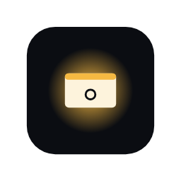
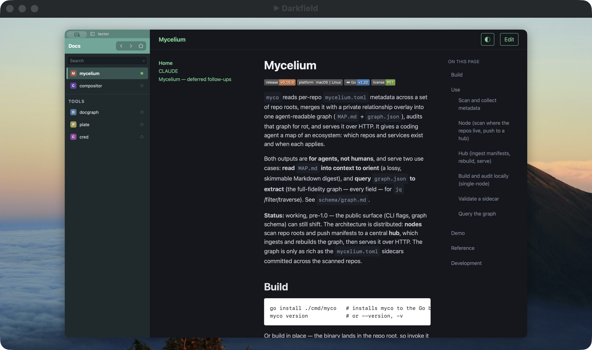

# darkfield

[](https://github.com/lockyc/darkfield/releases/latest)


[](LICENSE)

Present only the windows you choose. darkfield puts the windows you pick onto a clean 16:9
canvas over your desktop wallpaper. You share that canvas in Zoom, Meet or Teams, or show it
full-screen on a projector. Notifications, desktop icons and every other window stay off it, and
an audience pointer shows where you're pointing.



## Install

```bash
curl -fsSL https://raw.githubusercontent.com/lockyc/darkfield/main/install.sh | bash
```

Needs macOS 14 or later. The installer downloads the latest release, checks that it is signed and
notarized, installs `/Applications/darkfield.app` and launches it. darkfield then updates itself:
it checks daily, and **Check for Updates…** in its panel checks now.

## First run

Allow darkfield in System Settings → Privacy & Security → Screen Recording; until you do, its
panel says so and has a button that opens the setting. darkfield lives in the menu bar, with no
Dock icon. Opening it again from Spotlight or Finder brings back the preview.

The first time you turn on the camera **Preview**, allow darkfield to use the camera. Darkfield
Camera is a system extension: allow it once in System Settings → General → Login Items &
Extensions → Camera Extensions; the panel has a button that opens it. A video app that was
already open when you allowed it, or when darkfield updated, lists Darkfield Camera only after
you quit and reopen it.

## Features

- **Share a window** by pressing **⇧⌘1** over it, or with **Add Window…** in the panel; press
  ⇧⌘1 again to stop. A shared window keeps an amber ring around it while it's shared.
- **Show a window unscaled** by pressing **⇧⌘2** over it: darkfield resizes it to the canvas
  inside its margin, so the audience sees it pixel for pixel. The first press asks for
  Accessibility access in System Settings → Privacy & Security → Accessibility.
- **Shared windows stack** on the canvas, each scaled to fill it, in the same order as on your
  screen: the shared window you bring to the front is the one the audience sees.
- **In a call**, share the **▶ Darkfield** window from Zoom, Meet or Teams. It sits off screen at
  the canvas's full 1920×1080. You watch a small preview that floats above your windows on every
  Space and never appears in a share. With more than one display it opens by itself, and sharing
  a window brings it back; with one display it opens only from **Show Preview Window**. Its close
  button hides it. A picker that selects a window by clicking it (Meet in
  [cooee](https://github.com/lockyc/cooee)) has ▶ Darkfield shown centred on your main display
  while it is open; another app can do the same by posting the distributed notifications
  `com.lockyc.darkfield.pickerWillOpen` and `com.lockyc.darkfield.pickerDidClose`, opening its
  picker once darkfield answers with `com.lockyc.darkfield.pickerReady`.
- **On a projector**, set your displays to extended (not mirrored), then choose **Present to →
  Projector** in the panel. The canvas fills the projector, and your mouse stays on your own
  screen.
- **The audience pointer** is your cursor on the canvas, with an amber halo behind it so viewers
  find it. The halo fades after 10 seconds of stillness; shake the mouse to enlarge it, and clicks
  ripple. Turn it off in the panel, or give it a shortcut in Settings.
- **Darkfield Camera** shows you to any video app — Zoom, Teams, FaceTime, a browser call — from
  any camera you choose, with your background blurred and the shot framed to keep you in view,
  easing after you like Center Stage. Pick **Darkfield Camera** as the app's camera. **Blur** and
  **Framing** each switch on or off, with a strength and a Wide–Tight setting. The camera runs only
  while an app is using Darkfield Camera or the panel's **Preview** is on, and Preview turns off
  when the panel closes. Choose a **Camera** and, for when it's unplugged, a second one; with
  neither connected the call sees a dark frame, never a camera you didn't choose.
- **The panel** (the menu-bar icon) has two columns. The left holds the live canvas preview, the
  shared windows (✕ removes one), **Present to**, the margin and the pointer toggle; the right
  holds the camera: its preview (**Mirror preview** flips only your view of it), the camera
  choice, Blur and Framing.
- **Settings** — the share and pointer shortcuts, the halo's fade time, and the wallpaper behind
  the canvas: the primary display's, another display's, or an image you choose.

## Status

In use, `0.x`. Planned next: recording, the canvas as a camera, and cropping. The full list:
[docs/FOLLOWUPS.md](docs/FOLLOWUPS.md).

## Development

Needs Xcode's Swift 6 toolchain and [`just`](https://github.com/casey/just).

```bash
git clone https://github.com/lockyc/darkfield && cd darkfield
just test       # unit tests
just gate       # installer lint, build, tests
just install    # build, notarize, install to /Applications and launch
```

Architecture, conventions and the release process: [CLAUDE.md](CLAUDE.md).

## License

MIT — see [LICENSE](LICENSE).
